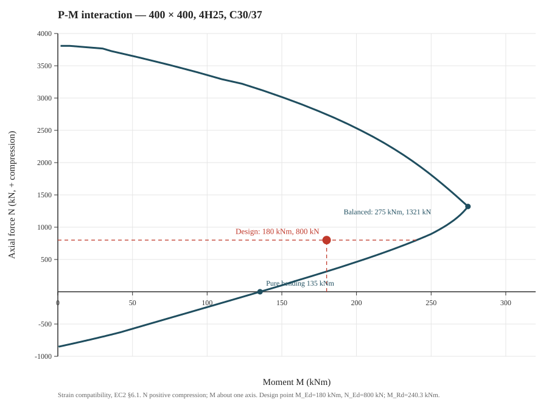

## The Problem

The 400 × 400 mm section of a column in a six-storey office building carries a design axial force `N_Ed = 800 kN` and a design moment `M_Ed = 180 kNm` about one axis. The section is C30/37 with 4H25, one bar at each corner, and H8 links. The task is to check the section at the ultimate limit state.

A column does not have a single moment capacity. The moment it can carry depends on the axial force: a small axial compression helps, a large one reduces the available moment. The answer is therefore a curve — the P-M interaction diagram — and a point on it.

## The Relevant Clauses

- §6.1(2)P: plane sections remain plane, the strain in bonded reinforcement equals the surrounding concrete, concrete tensile strength is ignored, and the stresses come from §3.1.7 (concrete) and §3.2 (steel)
- §6.1(3)P: the concrete compressive strain is limited to ε_cu3 (or ε_cu2); the steel strain to ε_ud where applicable
- §6.1(4): for compression-loaded sections, assume a minimum eccentricity `e₀ = max(h/30, 20 mm)`
- §3.1.6(1)P NOTE: α_cc = 1.0 is the recommended value; the French NA also adopts 1.0
- §3.1.7(3): for f_ck ≤ 50 MPa, the rectangular stress block uses λ = 0.8 and η = 1.0
- §3.2.7(2) and Fig 3.8: the design stress-strain curve for reinforcing steel is bilinear
- Table 3.1, §6.1(3)P: for C30/37, ε_cu3 = 3.5 ‰ and ε_c3 = 1.75 ‰
- §9.5.2(1)–(3): column longitudinal bars are at least 8 mm; `A_s,min = max(0.10 N_Ed/f_yd, 0.002 A_c)`; `A_s,max = 0.04 A_c` outside laps
- §5.8: slenderness and second-order effects are outside this section check; `N_Ed` and `M_Ed` are the design action effects, including the second-order moment if the column is slender

## Input Data

| Parameter | Value | Unit | Notes |
|-----------|-------|------|-------|
| Section h × b | 400 × 400 | mm | Rectangular section |
| Cover c_nom | 35 | mm | XC1, structural class S4 |
| Links | H8 | — | Transverse reinforcement |
| Main bars | 4H25 | — | One at each corner, A_s = 1963.5 mm² |
| f_ck | 30 | MPa | C30/37 |
| f_yk | 500 | MPa | B500B |
| γ_C / γ_S | 1.5 / 1.15 | — | Recommended values |
| α_cc | 1.0 | — | CEN recommended; French NA also 1.0 |
| N_Ed | 800 | kN | Compression positive |
| M_Ed | 180 | kNm | About one axis |
| e₀ | 20 | mm | max(400/30, 20) |

## Step-by-Step Calculation

### Step 1: Material Properties

Design concrete strength, §3.1.6(1)P Eq (3.15):

`f_cd = α_cc × f_ck / γ_C = 1.0 × 30 / 1.5 = 20.0 MPa`

Design steel strength, §3.2.7(2):

`f_yd = 500 / 1.15 = 434.8 MPa`

Stress-block factors for f_ck ≤ 50 MPa, §3.1.7(3):

`λ = 0.8` and `η = 1.0`

Strain limits from Table 3.1 and §6.1(3)P:

`ε_cu3 = 3.5 ‰` (compression) and `ε_c3 = 1.75 ‰`

Steel modulus `E_s = 200,000 MPa` (§3.2.7(4)). The steel yields at `ε_yd = f_yd/E_s = 2.174 ‰`.

### Step 2: Section and Bar Layout

Distance from the compression face to the bar centre:

`d′ = c_nom + φ_link + φ_main/2 = 35 + 8 + 25/2 = 55.5 mm`

The two top bars sit at `55.5 mm`; the two bottom bars at `400 − 55.5 = 344.5 mm`. The effective depth is `d = 344.5 mm`.

Area of four H25 bars:

`A_s = 4 × 490.9 = 1963.5 mm²`

Reinforcement ratio:

`ρ = 1963.5 / (400 × 400) = 1.23%`

### Step 3: The Strain Compatibility Idea

Pick a neutral-axis depth `x` measured from the compression face. Plane sections remain plane, so the strain at any depth `d_i` is, with compression negative and tension positive:

`ε_s,i = ε_c × (1 − d_i/x)`

For `x ≤ h`, the concrete at the compression face is at `ε_c = ε_cu3 = −3.5 ‰`. The concrete stress block is `η f_cd` over a depth `λx`; the steel stress follows the bilinear curve:

- tension: `σ_s = min(f_yd, ε_s E_s)`
- compression: `σ_s = max(−f_yd, ε_s E_s)`

The concrete tensile strength is ignored. For every bar inside the compression block, the concrete stress at the bar location is deducted from the steel stress so the displaced concrete is not counted twice.

The section forces are then:

`N = −(T_s + C_s + C_c)` (compression positive)

`M = [T_s(d_s,t − h/2) + C_s(d_s,c − h/2) + C_c(d_c − h/2)] / 1000` (kNm)

where `d_s,t`, `d_s,c` and `d_c` are the distances of the tensile steel, compressive steel and concrete resultants from the compression face. Change `x`, and you get another point on the interaction diagram.

### Step 4: One Complete Point — x = 134.70 mm

The design axial force is 800 kN. Because N increases monotonically with x, a bisection finds the depth that gives that N:

| x (mm) | N (kN) | M (kNm) |
|--------|--------|---------|
| 120 | 671.3 | 226.0 |
| 150 | 920.7 | 252.2 |
| **134.70** | **800.0** | **240.3** |

At `x = 134.70 mm`, the stress-block depth is `λx = 0.8 × 134.70 = 107.76 mm`.

**Top bars** at `d_i = 55.5 mm`:

`ε_s = −3.5 × (1 − 55.5/134.70) = −2.058 ‰`

`σ_s = max(−434.8, −2.058 × 200) = −411.6 MPa`

The bar is inside the compression block (`55.5 < 107.76`), so deduct the concrete stress of −20.0 MPa:

`σ_s,net = −411.6 − (−20.0) = −391.6 MPa`

`F_top = 490.9 × (−391.6) / 1000 = −192.2 kN` per bar → **−384.4 kN** for two bars.

**Bottom bars** at `d_i = 344.5 mm`:

`ε_s = −3.5 × (1 − 344.5/134.70) = +5.452 ‰`

`σ_s = min(434.8, 5.452 × 200) = +434.8 MPa` (yield)

`F_bottom = 490.9 × 434.8 / 1000 = +213.4 kN` per bar → **+426.8 kN** for two bars.

**Concrete**:

`A_cg = b × λx = 400 × 107.76 = 43,104 mm²`

Deduct the two top bars inside the block: `2 × 490.9 = 981.7 mm²`, leaving `42,122 mm²`.

`C_c = −20.0 × 42,122 / 1000 = −842.4 kN`

The block centroid is at `λx/2 = 53.88 mm` from the compression face.

**Equilibrium**:

`N = −(−384.4 + 426.8 − 842.4) = 800.0 kN` ✓

`M_Rd = [426.8 × (344.5 − 200) + (−384.4) × (55.5 − 200) + (−842.4) × (53.88 − 200)] / 1000 = 240.3 kNm`

So at `N_Ed = 800 kN`, the section resists `M_Rd = 240.3 kNm`.

### Step 5: Build the Interaction Diagram

Repeat the calculation for x from near zero to a depth beyond the section. The key points are:

| Point | x (mm) | N (kN) | M (kNm) | What it means |
|-------|--------|--------|---------|---------------|
| Pure tension | → 0 | −853.7 | 0 | All steel yields in tension |
| Pure bending | 59.49 | 0 | 135.4 | No axial force |
| Balanced | 212.51 | 1,320.8 | 274.7 | Bottom steel reaches ε_yd as concrete reaches ε_cu3 |
| Design point | 134.70 | 800.0 | 240.3 | M_Rd at N_Ed |
| Squash load (upper bound) | → ∞ | 4,014.4 | 0 | All steel at f_yd; see note below |

The curve rises from pure tension, passes through pure bending at 135.4 kNm, peaks at the balanced point (274.7 kNm at 1,320.8 kN), then falls as the axial force increases. Below the balanced point the section is **tension-controlled** — the bottom steel yields before the concrete crushes. Above it, the section is **compression-controlled** — the concrete crushes while the bottom steel is still elastic.

One note on the top of the curve: the squash load of 4,014.4 kN assumes every bar has reached `f_yd` in compression. The strain-compatibility curve uses the actual steel strains, which are limited by ε_c3 in the fully compressed state, so it approaches — but does not quite reach — that upper bound. The design point at 800 kN is far below this region.

### Step 6: Check the Design Point

`M_Ed / M_Rd = 180 / 240.3 = 0.75 ≤ 1.0` ✓

The design point is inside the envelope. For context, a moment of 250 kNm at the same axial force would give `250 / 240.3 = 1.04` — outside the curve. The section would need more reinforcement or a larger depth.

Minimum eccentricity, §6.1(4):

`e₀ = max(h/30, 20) = max(13.3, 20) = 20 mm`

Actual eccentricity:

`e = M_Ed / N_Ed = 180 / 800 × 1000 = 225 mm > 20 mm` ✓

### Step 7: Detailing Checks

Minimum longitudinal reinforcement, §9.5.2(2):

`A_s,min = max(0.10 × 800,000 / 434.8, 0.002 × 160,000) = max(184, 320) = 320 mm²`

`A_s,prov = 1,963.5 mm² > 320 mm²` ✓

Maximum longitudinal reinforcement, §9.5.2(3):

`A_s,max = 0.04 × 160,000 = 6,400 mm²`

`1,963.5 mm² < 6,400 mm²` ✓

Bar diameter, §9.5.2(1): `25 mm ≥ 8 mm` ✓

Not covered here: slenderness and second-order effects (§5.8), biaxial bending, shear, and anchorage. This is a section check: `N_Ed` and `M_Ed` are taken as given. A real column design must check slenderness and, if the column is slender, include the second-order moment in `M_Ed` before using this section.

## Result Summary

| Check | Required | Provided | Ratio | Pass? |
|-------|----------|----------|-------|-------|
| M_Ed ≤ M_Rd at N_Ed | 180 kNm | 240.3 kNm | 0.75 | ✅ |
| N_Ed ≤ N_Rd,max | 800 kN | 4,014 kN | 0.20 | ✅ |
| A_s,min (§9.5.2(2)) | 320 mm² | 1,963.5 mm² | 0.16 | ✅ |
| A_s,max (§9.5.2(3)) | 6,400 mm² | 1,963.5 mm² | 0.31 | ✅ |
| e ≥ e₀ (§6.1(4)) | 20 mm | 225 mm | 0.09 | ✅ |
| Bar diameter (§9.5.2(1)) | 8 mm | 25 mm | 0.32 | ✅ |

**Design: 400 × 400 mm, 4H25, H8 links — adequate for N_Ed = 800 kN and M_Ed = 180 kNm.**

## Download

📥 [Download the full calculation spreadsheet](/assets/ec2-column-pm-interaction.xlsx)

Five sheets: Inputs, the full P-M curve (with a chart), the design check, key points, and notes. The file regenerates from the Python script, so the numbers in the post and the spreadsheet cannot drift apart. Fully free — no gate, no signup.

If you spot a mistake or want a variation of this example, write to me at hugo@civion.cloud — corrections to published calculations go straight to the top of my list.

## What I'm Building

I'm building a tool that takes the section, the bars and the load cases, and returns this P-M diagram — plus the design check, the governing point, and a report. The interaction diagram is the part every column design needs and every spreadsheet rebuilds. If that sounds useful, write to me at hugo@civion.cloud and I'll tell you when it's ready.

---

*Verified against EN 1992-1-1 §6.1 by the author.*

---