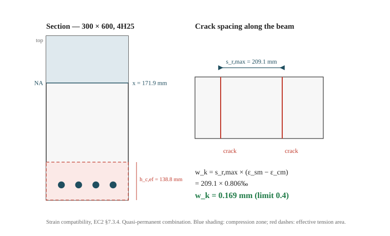

## The Problem

This is the same 6 m beam from the shear worked example: 300 × 600 mm, C30/37, B500B, 4H25 main bars on a 35 mm cover. Ultimate limit state was covered there. Now the beam is in service, and the question is how wide its cracks will open under the quasi-permanent combination. The relevant action is not the design load — it is the load the beam carries most of its life. Get this wrong in either direction and you either over-reinforce the section or hand over a beam with cracks wider than the limit allows.

## The Relevant Clauses

- §7.1(2): a section is treated as uncracked only if the maximum tensile stress ≤ f_ctm
- §7.3.1(5), Table 7.1N: crack width limit w_max = 0.4 mm for X0/XC1, quasi-permanent combination
- §7.3.2(2)–(3): f_ct,eff and the effective tension area h_c,eff
- §7.3.3, Table 7.2N: simplified control by bar diameter (cross-check)
- §7.3.4(1), Eq (7.8): w_k = s_r,max (ε_sm − ε_cm)
- §7.3.4(2), Eq (7.9): strain difference, with the 0.6σ_s/E_s floor
- §7.3.4(3), Eq (7.11): maximum crack spacing
- §7.3.4(3), Eq (7.14): upper bound where bonded reinforcement is widely spaced
- EN 1990 Annex A1, Table A1.1: ψ₂ for an office (category B)

## Input Data

| Parameter | Value | Unit | Notes |
|-----------|-------|------|-------|
| Span L | 6000 | mm | Simply supported |
| b | 300 | mm | Beam width |
| h | 600 | mm | Overall depth |
| g_k | 35 | kN/m | Permanent — same as the shear post |
| q_k | 20 | kN/m | Office, EN 1990 category B |
| ψ₂ | 0.3 | — | EN 1990 Annex A1, Table A1.1 — category B |
| f_ck | 30 | MPa | C30/37 |
| f_ctm | 2.9 | MPa | Table 3.1 |
| E_cm | 33 000 | MPa | Table 3.1 |
| f_yk | 500 | MPa | B500B |
| Main bars | 4H25 | — | A_s = 1963.5 mm² |
| c_nom | 35 | mm | XC1, structural class S4 |
| Links | H8 | — | |
| w_max | 0.4 | mm | §7.3.1(5), Table 7.1N — X0/XC1 |

## Step-by-Step Calculation

### Step 1: The Quasi-Permanent Action

Crack widths are checked under the combination the structure carries for most of its life. For category B (office), ψ₂ = 0.3. The quasi-permanent load is:

w_qp = g_k + ψ₂ q_k = 35 + 0.3 × 20 = **41.0 kN/m**

M_qp = w_qp L²/8 = 41.0 × 6.0²/8 = **184.5 kNm**

Compare this with the ultimate moment, 347.6 kNm. The service moment is 53% of it — that ratio matters later, because σ_s controls everything downstream.

### Step 2: Effective Depth

d = h − c_nom − φ_link − φ/2 = 600 − 35 − 8 − 12.5 = **544.5 mm**

The same value used in the shear post. The 55.5 mm from the tension face to the bar centre is the d′ that will reappear in the section analysis.

### Step 3: Cracked Section — Neutral Axis and Steel Stress

§7.1(2) says a section may be treated as uncracked only if the maximum tensile stress under the serviceability combination does not exceed f_ctm. The uncracked transformed section (gross concrete plus (α_e − 1)A_s at the bar centroid) gives W_b = 20.76 × 10⁶ mm³, so:

σ_ct = M_qp/W_b = 184.5 × 10⁶ / 20.76 × 10⁶ = **8.89 MPa**

That is well above f_ctm = 2.9 MPa, so the section is cracked and a cracked transformed section applies. Equation (7.9) defines σ_s as the stress in the tension reinforcement assuming a cracked section, and α_e as the ratio E_s/E_cm (notation to Eq 7.9):

α_e = E_s/E_cm = 200 000/33 000 = **6.06**

The first moment of area about the neutral axis gives:

b x²/2 = α_e A_s (d − x)

150 x² = 6.06 × 1963.5 × (544.5 − x) = 11 900 (544.5 − x)

150 x² + 11 900 x − 6 479 800 = 0

x = [−11 900 + √(11 900² + 4 × 150 × 6 479 800)]/(2 × 150) = **171.9 mm**

The cracked second moment of area:

I_cr = b x³/3 + α_e A_s (d − x)²

I_cr = 300 × 171.9³/3 + 11 900 × (544.5 − 171.9)² = 5.08 × 10⁸ + 1.65 × 10⁹ = **2.160 × 10⁹ mm⁴**

The steel stress under the service moment:

σ_s = α_e M_qp (d − x)/I_cr = 6.06 × 184.5 × 10⁶ × 372.6 / 2.160 × 10⁹ = **192.9 MPa**

That is 39% of f_yk (44% of f_yd) — a comfortable service stress, and the reason the answer at the end will pass.

### Step 4: Effective Tension Area and Reinforcement Ratio

Only the concrete around the bars contributes to crack control. §7.3.2(3) defines the effective tension area by the smallest of three heights:

h_c,eff = min[2.5(h − d), (h − x)/3, h/2]

- 2.5 × 55.5 = **138.75 mm**
- (600 − 171.9)/3 = 142.7 mm
- 600/2 = 300 mm

So h_c,eff = **138.75 mm**, and:

A_c,eff = b h_c,eff = 300 × 138.75 = **41 625 mm²**

ρ_p,eff = A_s/A_c,eff = 1963.5/41 625 = **0.0472**

That is 4.7% — a high effective ratio, driven by the 138.75 mm tension zone. This is the single most influential number in the calculation.

### Step 5: Strain Difference — Eq (7.9)

The mean strain between steel and concrete, allowing for tension stiffening:

ε_sm − ε_cm = [σ_s − k_t f_ct,eff/ρ_p,eff (1 + α_e ρ_p,eff)]/E_s

k_t = 0.4 for long-term loading, and f_ct,eff = f_ctm = 2.9 MPa for cracking at 28 days:

- k_t f_ctm/ρ_p,eff = 0.4 × 2.9/0.0472 = 24.6 MPa
- (1 + α_e ρ_p,eff) = 1 + 6.06 × 0.0472 = 1.286
- term = 24.6 × 1.286 = **31.6 MPa**

ε_sm − ε_cm = (192.9 − 31.6)/200 000 = **0.806 × 10⁻³**

The lower bound:

0.6 σ_s/E_s = 0.6 × 192.9/200 000 = 0.579 × 10⁻³

The Eq (7.9) value governs. In most beams the floor does not control; it exists for cases where the reinforcement is lightly stressed and tension stiffening would otherwise give a very small strain.

### Step 6: Maximum Crack Spacing — Eq (7.11)

s_r,max = k₃ c + k₁ k₂ k₄ φ/ρ_p,eff

with k₁ = 0.8 (high-bond bars), k₂ = 0.5 (bending), k₃ = 3.4, k₄ = 0.425 — the CEN recommended values:

- k₃ c = 3.4 × 35 = 119.0 mm
- k₁ k₂ k₄ φ/ρ_p,eff = 0.8 × 0.5 × 0.425 × 25/0.0472 = 90.1 mm

s_r,max = **209.1 mm**

Before using Eq (7.11), confirm the bars are closely spaced enough for it to apply. Clear spacing:

(300 − 2 × 35 − 2 × 8 − 4 × 25)/3 = **38 mm**

The limit is 5(c + φ/2) = 5 × (35 + 12.5) = 237.5 mm. The bars are well within it, so Eq (7.11) applies under the CEN text.

### Step 7: Crack Width — Eq (7.8)

w_k = s_r,max (ε_sm − ε_cm) = 209.1 × 0.806 × 10⁻³ = **0.169 mm**

Against the 0.4 mm limit, the ratio is 0.42 — the section passes with margin. XC1 is a dry internal exposure: Table 7.1N sets 0.4 mm here as an appearance limit, not a durability one.

### Step 8: Two Cross-Checks

**Table 7.2N.** At σ_s = 192.9 MPa and w_k = 0.4 mm, the table gives a maximum bar diameter between 40 mm (at 160 MPa) and 32 mm (at 200 MPa), interpolating to about **33.4 mm**. The provided 25 mm bars pass.

**Eq (7.14), for reference.** The upper bound 1.3(h − x) = 1.3 × 428.1 = **556.5 mm** would give w_k = 0.449 mm — a fail against the 0.4 mm limit (ratio 1.12). Under the CEN text Eq (7.14) is an upper bound for situations where bonded reinforcement spacing exceeds 5(c + φ/2) or there is no bonded reinforcement in the tension zone; neither applies here. Some National Annexes take a different view and apply Eq (7.14) whenever it exceeds Eq (7.11) — the French NA is one. Civion computes the CEN route by default and evaluates the NF NA alternative alongside it, so the report shows both. If your NA is one of them, this beam fails at 0.449 mm and needs either more bars or a smaller diameter.

## Result Summary

| Check | Value | Limit | Ratio | Pass? |
|-------|-------|-------|-------|-------|
| x (cracked) | 171.9 mm | — | — | — |
| σ_s under M_qp | 192.9 MPa | — | — | — |
| h_c,eff | 138.75 mm | — | — | — |
| ρ_p,eff | 4.72% | — | — | — |
| s_r,max, Eq (7.11) | 209.1 mm | — | — | — |
| w_k, Eq (7.8) | 0.169 mm | 0.400 mm | 0.42 | ✅ |
| Bar diameter, Table 7.2N | 25 mm | ≈33.4 mm | 0.75 | ✅ |
| w_k using Eq (7.14) | 0.449 mm | 0.400 mm | 1.12 | ❌ (NA-dependent) |

## Download

📥 [Download the full calculation spreadsheet](/assets/ec2-crack-width-rectangular-beam.xlsx)

The workbook carries the inputs, the step-by-step calculation and the notes — every intermediate value in this post, ready to compare against your own sheet. Fully free — no gate, no signup.

## What I'm Building

Crack width is where a section design usually ends, and it is the check most often skipped by spreadsheet-built beams. I'm building Civion to run the ULS checks and this SLS check on the same section, so the answer comes with the reinforcement layout that satisfies both. If that sounds useful, write to me at <hugo@civion.cloud> and I'll tell you when it's ready.

---