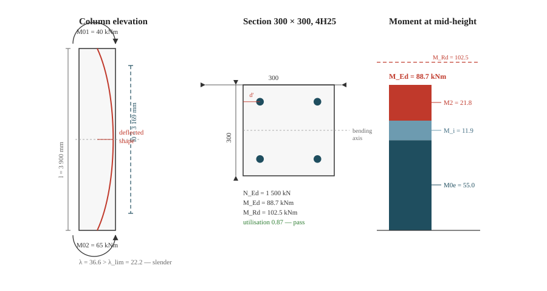

## The Problem

A 300 × 300 column carrying 1 500 kN over a 3.9 m clear storey height looks unremarkable until you run the slenderness check. The slenderness ratio is 36.6; the limit is 22.2. This column is slender, and a slender column does not resist the moment your frame analysis gave it — it resists that moment plus the moment from its own deflection, and the addition grows as the axial load approaches the buckling load. Ignore it and the section is designed for about a third less moment than it should be. Apply it where it is not needed and you pay for steel you never use. This post works the EC2 route end to end and finishes with the section check on the P-M interaction diagram.

## The Relevant Clauses

- §5.8.3.1(1) Note, Eq (5.13N): slenderness limit λ_lim = 20·A·B·C/√n — A = 0.7 and B = 1.1 may be used when φ_ef and ω are unknown
- §5.8.3.2(1), Eq (5.14): slenderness ratio λ = l₀/i
- §5.8.3.2(3), Eq (5.15): effective length of a braced member
- §5.2(7), Eq (5.2): geometric imperfection, e_i = θ_i·l₀/2, simplified to l₀/400 for isolated columns in braced systems
- §5.8.8.2(2), Eq (5.32): equivalent first-order moment M₀e = 0.6M₀₂ + 0.4M₀₁ ≥ 0.4M₀₂
- §5.8.8.2(3), Eq (5.33): nominal second-order moment M₂ = N_Ed·e₂, with e₂ = (1/r)·l₀²/c
- §5.8.8.2(4): c = 10 (≈ π²) normally; 8 is the lower limit for a constant first-order moment
- §6.1(4): minimum eccentricity e₀ = h/30, not less than 20 mm, for symmetrically reinforced sections in compression
- §5.8.8.3(1), Eq (5.34): curvature 1/r = K_r·K_φ·1/r₀, with 1/r₀ = ε_yd/(0.45d)
- §5.8.8.3(3), Eq (5.36): K_r = (n_u − n)/(n_u − n_bal) ≤ 1.0, n_bal = n at maximum moment resistance (0.4 may be used)
- §5.8.8.3(4), Eq (5.37): K_φ = 1 + β·φ_ef ≥ 1, with β = 0.35 + f_ck/200 − λ/150
- §5.8.7.2, Eqs (5.21)–(5.22): nominal stiffness EI = K_c·E_cd·I_c + K_s·E_s·I_s, K_c = k₁k₂/(1 + φ_ef)
- §5.8.7.3(1), Eq (5.28): magnification M_Ed = M₀Ed[1 + β/(N_B/N_Ed − 1)], β = π²/c₀ by Eq (5.29)
- §5.8.8.2(1), Eq (5.31): M_Ed = M₀Ed + M₂
- §9.5.2(2)–(3): minimum and maximum reinforcement ratios

## Input Data

| Parameter | Value | Unit | Notes |
|-----------|-------|------|-------|
| b × h | 300 × 300 | mm | Braced column, office building |
| Clear height l | 3 900 | mm | Between beam soffits |
| N_Ed | 1 500 | kN | Design axial compression |
| M₀₁ | 40 | kNm | Numerically smaller end moment |
| M₀₂ | 65 | kNm | Numerically larger end moment, same sign (single curvature) |
| k₁ = k₂ | 0.75 | — | Beam/column stiffness at each joint |
| φ_ef | 0.90 | — | Effective creep coefficient |
| f_ck | 30 | MPa | C30/37 |
| f_yk | 500 | MPa | B500B |
| c_nom | 35 | mm | XC1, structural class S4 |
| Links | H8 | — | |
| Main bars | 4H25 | — | A_s = 1 963.5 mm² |

## Step-by-Step Calculation

### Step 1: Material Properties and Section Geometry

f_cd = α_cc·f_ck/γ_c = 1.0 × 30/1.5 = **20.00 MPa**

The value α_cc = 1.0 follows the CEN recommended value in the §3.1.6(1)P NOTE; the French National Annex also adopts 1.0, the UK NA uses 0.85. This post stays on the CEN route.

f_yd = f_yk/γ_s = 500/1.15 = **434.8 MPa**

ε_yd = f_yd/E_s = 434.8/200 000 = **0.00217**

d′ = c_nom + φ_link + φ/2 = 35 + 8 + 12.5 = **55.5 mm**

d = h − d′ = 300 − 55.5 = **244.5 mm**

A_s = 4 × 490.9 = **1 963.5 mm²** (ρ = 2.18%)

### Step 2: Effective Length

The column is braced, so sidesway of the frame is carried elsewhere. §5.8.3.2(3) gives the effective length of a braced member:

l₀ = 0.5·l·√[(1 + k₁/(0.45 + k₁))·(1 + k₂/(0.45 + k₂))]

With k₁ = k₂ = 0.75:

k/(0.45 + k) = 0.75/1.20 = 0.625

l₀ = 0.5 × 3 900 × √(1.625 × 1.625) = 0.5 × 3 900 × 1.625 = **3 169 mm**

That is 0.812·l. The 0.75 value assumes beams at the joints provide roughly three quarters of the column's own rotational stiffness. On a job where the beams are shallower than the column, k approaches 1.0 and l₀ grows; this is the single input in the whole calculation most worth checking against the actual frame.

### Step 3: Slenderness Ratio and the Limit

The radius of gyration for a rectangular section is i = h/√12 = 300/3.464 = **86.6 mm**.

λ = l₀/i = 3 169/86.6 = **36.6**

Now the limit. §5.8.3.1(3), Eq (5.13N):

λ_lim = 20·A·B·C/√n

- n = N_Ed/(A_c·f_cd) = 1 500 000/(90 000 × 20) = **0.833**
- A = 1/(1 + 0.2φ_ef) = 1/(1 + 0.18) = **0.847**
- B = 1.1 — the recommended value when the reinforcement is not yet known
- C = 1.7 − M₀₁/M₀₂ = 1.7 − 40/65 = **1.085**

λ_lim = 20 × 0.847 × 1.1 × 1.085/√0.833 = **22.2**

λ = 36.6 is well above the limit, so the column is slender and second-order effects must be considered.

There is a shortcut worth knowing. If φ_ef is unknown, A may be taken as 0.7; if the reinforcement is unknown, B as 1.1. Substitute those two "absence of information" values and 20 × 0.7 × 1.1 = 15.4, so the limit collapses to:

λ_lim = 15.4·C/√n = 15.4 × 1.085/0.913 = **18.3**

That is more conservative than this column needs, because we do know φ_ef = 0.9. The expression is often quoted as a standalone formula; it is Eq (5.13N) with the default parameters substituted, not a second rule in the code. Either value classifies this column as slender.

The choice of B does not change the conclusion either. Using the final 4H25 reinforcement, B = √(1 + 2ω) = 1.39, which raises the limit to 20 × 0.847 × 1.39 × 1.085/0.913 = **28.0**. The column is still slender at 36.6 > 28.0.

### Step 4: First-Order Moments, Including Imperfections

Beams frame into the column at both ends. The frame analysis gives end moments of 65 kNm and 40 kNm that act in the same sense — both give tension on the same face — so the column bends in single curvature and r_m = +40/65 = +0.615. The equivalent first-order moment near mid-height, §5.8.8.2(2), Eq (5.32):

M₀e = max(0.6M₀₂ + 0.4M₀₁, 0.4M₀₂) = max(0.6 × 65 + 0.4 × 40, 0.4 × 65) = max(55.0, 26.0) = **55.0 kNm**

The column cannot be built perfectly straight. §5.2(7) allows the imperfection to be represented by an additional eccentricity at mid-height of l₀/400 for an isolated member:

e_i = 3 169/400 = **7.92 mm**

M_i = N_Ed·e_i = 1 500 × 0.00792 = **11.9 kNm**

The imperfection moment is added to the equivalent first-order moment, not to the end moments, because it is largest at mid-height:

M₀Ed = M₀e + M_i = 55.0 + 11.9 = **66.9 kNm**

The minimum eccentricity of §6.1(4), e₀ = max(h/30, 20) = 20 mm, gives 30.0 kNm — well below M₀Ed, so it does not govern.

### Step 5: The Nominal Curvature — K_r and K_φ

The nominal curvature method estimates the curvature at the section when the concrete reaches its ultimate strain, then converts that curvature into a deflection. Two corrections reduce the balanced-section curvature: one for the axial load, one for creep.

ω = A_s·f_yd/(A_c·f_cd) = 1 963.5 × 434.8/(90 000 × 20) = **0.474**

n_u = 1 + ω = **1.474**

K_r = (n_u − n)/(n_u − n_bal) = (1.474 − 0.833)/(1.474 − 0.40) = **0.597**

n_bal is the value of n at the section's maximum moment resistance, and §5.8.8.3(3) permits the value 0.40 to be used. For this section the maximum moment resistance — 142.0 kNm — occurs at n = 0.38 (x = 150.8 mm), so 0.40 is marginally on the safe side: it raises K_r from 0.586 to 0.597.

β = 0.35 + f_ck/200 − λ/150 = 0.35 + 0.15 − 0.244 = **0.256**

K_φ = max(1.0, 1 + β·φ_ef) = 1 + 0.256 × 0.90 = **1.230**

K_r is the more influential of the two: it is 0.597 here because the relative normal force is 0.833, and a heavily loaded column has less curvature available before the concrete crushes.

### Step 6: Second-Order Eccentricity and Moment

The balanced-section curvature, defined in §5.8.8.3(1):

1/r₀ = ε_yd/(0.45d) = 0.00217/(0.45 × 244.5) = **1.976 × 10⁻⁵ mm⁻¹**

The design curvature, Eq (5.34):

1/r = K_r·K_φ·1/r₀ = 0.597 × 1.230 × 1.976 × 10⁻⁵ = **1.451 × 10⁻⁵ mm⁻¹**

§5.8.8.2(4) gives c = 10 (≈ π²) for a constant cross-section. With that value, Eq (5.33):

e₂ = (1/r)·l₀²/c = 1.451 × 10⁻⁵ × 3 169²/10 = **14.56 mm**

M₂ = N_Ed·e₂ = 1 500 × 0.01456 = **21.8 kNm**

The design moment at the critical section:

M_Ed = M₀Ed + M₂ = 66.9 + 21.8 = **88.7 kNm**

The second-order moment is 33% of the first-order moment. That is what the slenderness check bought us: the section has to be designed for 88.7 kNm, not 66.9 kNm.

### Step 7: The Section Check

The moment alone does not tell you whether the column works — the axial load changes the available moment capacity. This is the same strain-compatibility calculation as the [EC2 §6.1 column P-M post](/2026/11/02/ec2-column-pm-interaction-rectangular.html), read at a different point on the curve. At N_Ed = 1 500 kN it gives a neutral-axis depth x = 236.6 mm and a resistance of:

M_Rd = **102.5 kNm** at N_Ed = 1 500 kN

M_Ed/M_Rd = 88.7/102.5 = **0.87** — the section passes.

Two other checks confirm the section is sensible. The squash load is N_Rd = f_cd(A_c − A_s) + f_yd·A_s = 2 614 kN, so the column is working at 57% of its axial capacity. And the reinforcement, ρ = 2.18%, sits comfortably between the §9.5.2 limits of 0.2% and 4% (A_s,min = 345 mm², A_s,max = 3 600 mm²).

### Step 8: Two Cross-Checks

**Nominal stiffness magnification.** §5.8.7 offers an independent route: estimate a cracked stiffness, find the buckling load, and amplify the first-order moment. With K_c = 0.1156 and EI = 5.653 × 10¹² N·mm², the buckling load is N_B = π²EI/l₀² = 5 557 kN. Then Eq (5.28):

M_Ed = M₀Ed·[1 + (π²/8)/(N_B/N_Ed − 1)] = 66.9 × [1 + 1.234/(3.705 − 1)] = **97.4 kNm**

That is 10% above the nominal curvature answer, and the utilisation rises to 0.95. Both methods pass, but the margin is no longer comfortable. When two permitted methods differ by 10%, the honest design value is the higher one unless you have a reason to prefer the lower.

**Sensitivity to c.** The factor c in the e₂ expression depends on the curvature distribution, not the first-order moment. §5.8.8.2(4) says c = 10 (≈ π²) is normally used for a constant cross-section, and that 8 is a lower limit corresponding to a constant first-order moment. This column's first-order moment varies from 40 to 65 kNm, so c = 10 applies. For reference, c = 8 would give e₂ = 18.2 mm and M_Ed = 94.2 kNm — a utilisation of 0.92. The choice moves the answer by about 6%, which is worth stating rather than burying in a spreadsheet cell.

## Result Summary

| Check | Value | Reference | Ratio | Result |
|-------|-------|-----------|-------|--------|
| λ vs λ_lim | 36.6 | 22.2 | 1.65 | Slender — second order required |
| M₀Ed | 66.9 kNm | — | — | First order + imperfection |
| M₂ | 21.8 kNm | — | — | Second order |
| M_Ed (nominal curvature) | 88.7 kNm | 102.5 kNm | 0.87 | ✅ |
| M_Ed (c = 8, lower limit) | 94.2 kNm | 102.5 kNm | 0.92 | ✅ |
| M_Ed (magnifier) | 97.4 kNm | 102.5 kNm | 0.95 | ✅ |
| N_Ed/N_Rd,squash | 1 500 kN | 2 614 kN | 0.57 | ✅ |
| ρ | 2.18% | 0.2–4% | — | ✅ |

## Download

📥 [Download the full calculation spreadsheet](/assets/ec2-column-slenderness.xlsx)

The workbook carries the inputs, every intermediate value above, and the notes on assumptions — ready to compare against your own sheet. Fully free — no gate, no signup.

## What I'm Building

Slenderness is the check that decides which moment you are actually designing for, and it is the one most often left out of a section spreadsheet. I'm building Civion's EC2 RC Column Section Designer to run the slenderness check and the P-M interaction on the same column, so the second-order moment feeds straight into the section check instead of being retyped. If that sounds useful, write to me at <hugo@civion.cloud> and I'll tell you when it's ready.

---